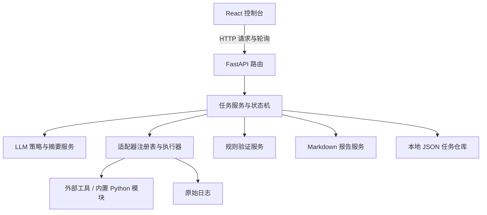

# 架构与源码导航

[返回项目首页](../../README.md) · [文档目录](../README.md)

## 系统分层



LLM 与执行器之间通过结构化策略传递工具标识符和扫描上下文，不直接执行模型生成的任意 Shell 文本。该约束不等于完整的输入安全校验或执行沙箱。

## 推荐阅读顺序

以下链接均指向可直接查看的源码。

| 顺序 | 入口 | 关注点 |
| --- | --- | --- |
| 1 | [任务服务](../../backend/app/services/task_service.py) | 阶段执行、自动运行、手动推进、锁与状态保存 |
| 2 | [状态机](../../backend/app/orchestrator/machine.py) / [状态定义](../../backend/app/orchestrator/states.py) | 固定阶段与进度计算 |
| 3 | [LLM 服务](../../backend/app/services/llm_service.py) | 双协议接入、结构化输出、工具过滤与规则回退 |
| 4 | [适配器基类](../../backend/app/adapters/tools/base.py) / [注册表](../../backend/app/adapters/tools/registry.py) / [执行器](../../backend/app/adapters/tools/executor.py) | 工具抽象、子进程执行、模拟回退和日志 |
| 5 | [验证服务](../../backend/app/services/verification_service.py) / [报告服务](../../backend/app/services/report_service.py) | 证据规则、发现结构、目标评估与 Markdown 输出 |
| 6 | [前端页面](../../frontend/src/App.tsx) / [API 客户端](../../frontend/src/services/api.ts) | 任务交互、轮询、时间线与报告预览 |
| 7 | [后端测试](../../backend/tests/test_api.py) | API、策略、工具参数、验证规则和工作流测试 |

## 任务执行模型

正常状态流转：

```text
PENDING → RECON → ANALYSIS → SCAN → VERIFY → POST_VERIFY → REPORTING → COMPLETED
```

- `start_task` 启动后台守护线程，线程循环推进任务。自动执行异常进入 `FAILED` 并记录错误。
- 手动 `advance` 每次推进一个阶段；自动运行中禁止手动推进。
- `service_lock` 是进程内全局 `RLock`，阶段执行期间持锁，因此耗时扫描也会阻塞其他需要该锁的任务操作。
- 任务通过本地 JSON 保存并在服务初始化时加载。后台线程不持久化，进程重启没有恢复运行中任务的逻辑。
- `POST_VERIFY` 记录证据整理阶段的说明；原始输出实际由执行器在每次执行时写入，不存在独立的证据归档引擎。

不要使用多 Uvicorn worker 共享这些任务文件，也不要将此模型描述为分布式队列或高并发调度。

## LLM 策略与回退

[任务模型](../../backend/app/schemas/task.py)中的 `LLMStrategyPlan` 包含摘要、优先级、推荐工具、关注点、重点路径、验证目标、停止条件及理由。

1. 侦察阶段的工具结果作为模型输入。
2. 模型响应中的 JSON 经 Pydantic 校验，推荐工具按允许列表过滤，重点路径经规范化与数量限制。
3. 模型策略经过可达性检查，缺少可确认的 Web 服务信号时可清空扫描工具选择。
4. 没有密钥、请求失败或响应解析失败时使用规则策略；该回退分支不经过同一套可达性保护，行为不能与模型分支完全等同。
5. 扫描阶段根据工具标识符筛选注册适配器，并传递路径、关注点和验证目标。执行顺序由注册表决定，不由模型列表重新排序。
6. 验证服务评估目标与停止条件，输出建议；任务服务不会据此自动回到扫描阶段或重新规划。

Responses 接口提取 `output_text`；Chat Completions 接口累积 SSE 中的内容片段。验证摘要和报告摘要也支持模型生成，并各自提供回退文字。

## 工具适配器与执行边界

`ToolAdapter` 定义命令构建、执行计划、原生结果解析和模拟结果接口。执行器统一设置超时（默认 20 秒），通过参数列表调用子进程并记录原始日志、退出码与耗时。

| 阶段 | 适配器 | 执行依赖或职责 |
| --- | --- | --- |
| 侦察 | `nmap` | Nmap 服务探测 |
| 侦察 | `httpx` | ProjectDiscovery httpx HTTP 信息收集 |
| 侦察 | `web_fingerprint` | 内置 Python Web 指纹模块 |
| 扫描 | `path_probe` | 重点路径与常见应用路径探测 |
| 扫描 | `input_surface` | 表单与同源动态入口发现 |
| 扫描 | `param_injection_probe` | 参数变异产生的错误或时间信号 |
| 扫描 | `command_probe` | 低影响标记验证命令执行信号 |
| 扫描 | `login_sqli_probe` | 登录表单基线与注入响应对比 |
| 扫描 | `sensitive_file_probe` | 常见敏感文件与备份暴露检查 |
| 扫描 | `heartbleed_probe` | 调用 Nmap 的 Heartbleed NSE 检查 |
| 扫描 | `nuclei` | 仓库内本地 HTTP 指纹模板 |

`whatweb_adapter.py` 与 `demo_recon.py` 保留在源码中，但不在默认注册表里。不要把文件存在等同于默认流程已集成。

工具不存在时，执行器写入带模拟标识的日志并返回 `simulated` 结果。验证服务未统一排除模拟证据，因此下游的 `verified` 不能脱离执行模式单独解释。部分内置 Python 探测模块会真实请求目标，即使其他适配器处于模拟模式。

## 数据与报告

| 路径 | 内容 |
| --- | --- |
| `data/tasks/<task-id>.json` | 完整任务、时间线、策略、工具结果和报告元数据 |
| `data/raw/<task-id>/` | 命令、标准输出、标准错误或模拟日志 |
| `data/reports/<task-id>/` | Markdown 报告 |
| `data/evidence/` | 预留目录；主流程没有独立写入逻辑 |

结构定义见[任务模型](../../backend/app/schemas/task.py)和[工具模型](../../backend/app/schemas/tool.py)。

- `ToolExecutionResult` 记录成功标记、执行模式、原始日志路径、退出码、耗时及证据文字。
- `VerifiedFinding` 记录严重性、置信度、验证状态、影响、修复建议与产物引用。
- 验证状态为 `verified`、`informational` 或 `rejected`。已确认 HTTP 可达性等攻击面信息也可能标为 `verified`。
- 报告包含摘要、目标、LLM 策略、验证说明、发现统计、工具执行摘要和证据路径。

这些目录中的运行产物不纳入版本控制。报告和任务文件可能包含敏感信息，外发前必须脱敏。

## HTTP API

| 方法 | 路径 | 用途 |
| --- | --- | --- |
| GET | `/health` | 健康检查 |
| GET | `/api/tasks` | 任务列表 |
| POST | `/api/tasks` | 创建任务，输入 `target` 与 `scenario` |
| GET | `/api/tasks/{task_id}` | 任务详情 |
| POST | `/api/tasks/{task_id}/advance` | 手动推进阶段 |
| POST | `/api/tasks/{task_id}/start` | 启动自动流程 |
| GET | `/api/tasks/{task_id}/report` | 获取报告路径与 Markdown 内容 |

交互式 API 文档位于 `/docs`。前端通过 HTTP 轮询更新状态，没有 WebSocket 推送。报告接口返回 JSON 中的 Markdown 内容，不是独立文件下载接口。

## 修改与扩展约定

- 添加工具时实现适配器接口，在 `registry.py` 注册；如果由 LLM 选择，还需同步 `llm_service.py` 的允许列表与提示词，并补齐验证规则与测试。
- 添加任务字段时同步后端 Pydantic 模型、前端 `src/types/task.ts` 和展示逻辑。
- 修改监听端口时核对前端 API 地址与后端 CORS；配置细节见[安装与配置](../setup/GETTING_STARTED.md)。
- 调整阶段时同时修改状态定义、转换规则、任务服务、前端阶段展示及相关测试。
- 测试不是完全隔离的：文件产物与本机工具会影响执行，详见[开发验证](../setup/GETTING_STARTED.md#开发验证)。
